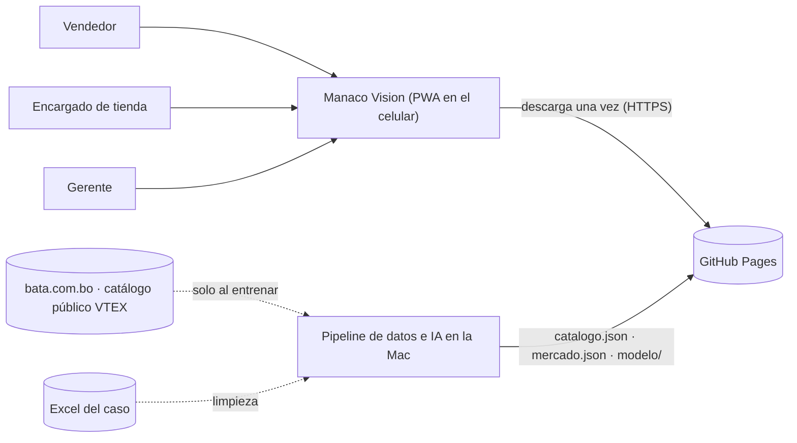
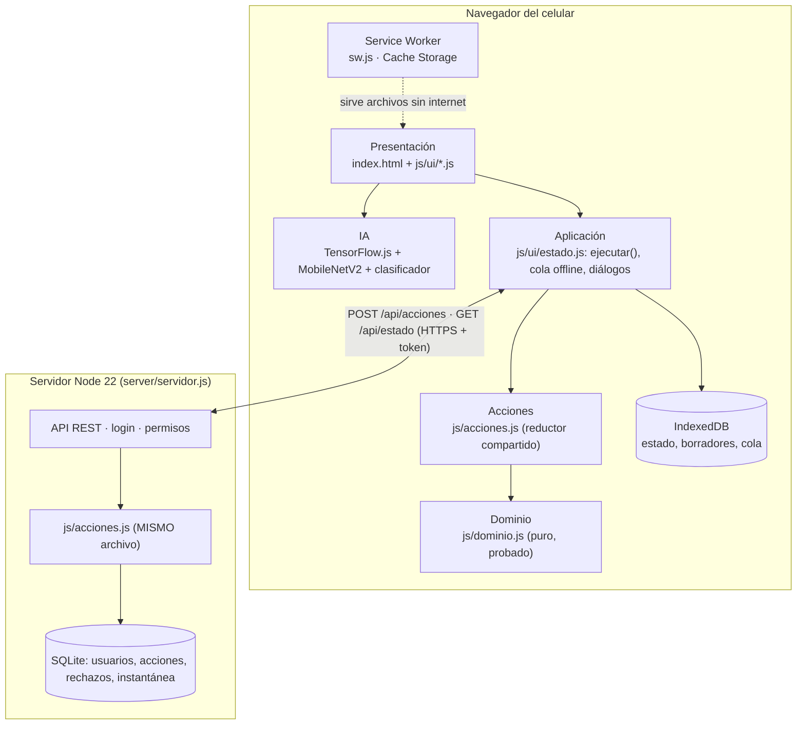
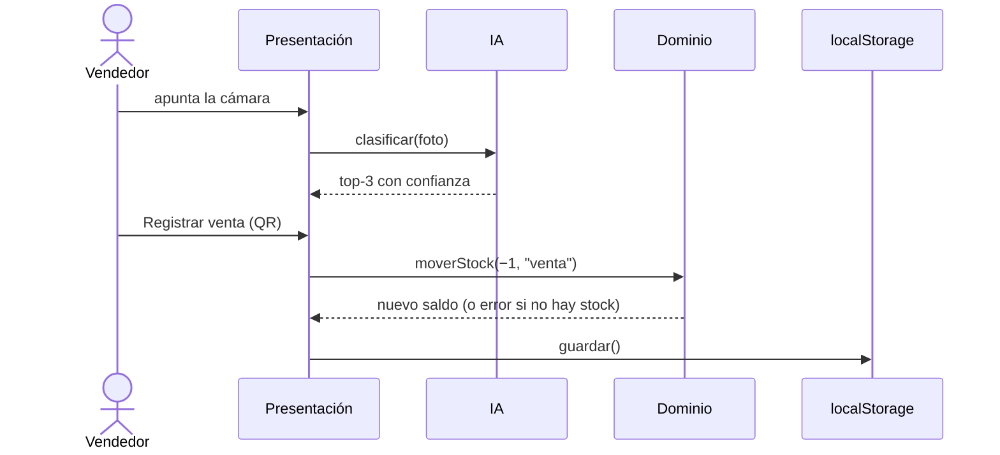
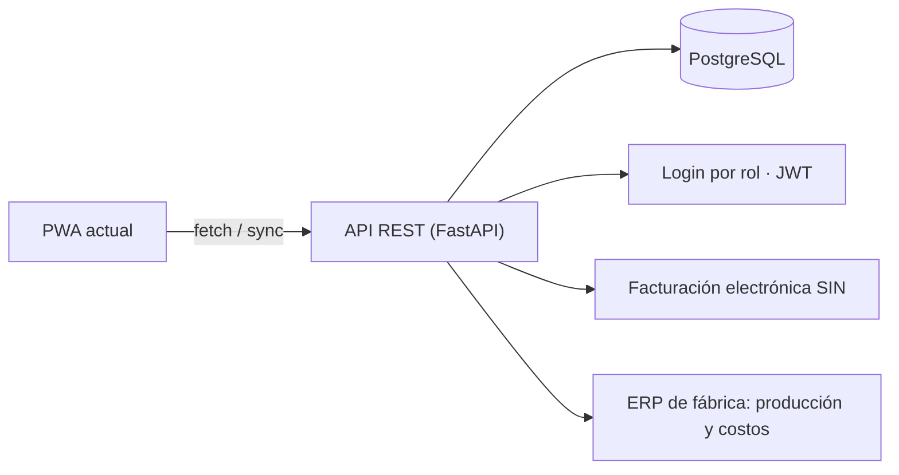

# Arquitectura

## 1. Estilo arquitectónico

**Cliente-servidor *offline-first* en capas, con patrón *command* (acciones) y reglas compartidas.** La PWA funciona sola (modo demo) o conectada al servidor (modo servidor, datos compartidos por las 3 tiendas). La IA siempre corre en el celular. Se eligió así porque:

- La cámara exige HTTPS, y GitHub Pages lo da gratis.
- Las tiendas pueden quedarse sin internet; la app sigue funcionando.
- La IA en el dispositivo responde en menos de 1 s, sin costo de servidor y sin enviar fotos a terceros.

## 2. Vista de contexto (C4 – nivel 1)



## 3. Vista de contenedores y capas (C4 – nivel 2)



| Capa | Archivos | Responsabilidad | Regla |
|---|---|---|---|
| **Presentación** | `index.html`, `js/ui/*.js` | Dibujar pantallas y capturar acciones del usuario | No calcula dinero ni stock por su cuenta: llama al dominio |
| **Dominio** | `js/dominio.js` | IVA 13 %, IT 3 %, utilidad, caja esperada, arqueo, kardex, exactitud de inventario (IRA), merma, cobertura, calidad y entregas, migración de datos | **Funciones puras**: sin DOM ni almacenamiento, por eso se prueban en Node |
| **IA** | `js/ui/ia.js`, `mobilenet/`, `modelo/` | Imagen → vector de 1.280 rasgos → clasificador denso → top-3 con confianza | Umbral 0,55; si duda, ofrece 3 opciones |
| **Aplicación** | `js/ui/estado.js` | `ejecutar(tipo, datos)`, IndexedDB, cola offline, sincronización y diálogos | La vista nunca modifica `S` directamente |
| **Acciones** | `js/acciones.js` | Reductor: permisos por rol, validación y aplicación de las 11 operaciones; idempotente | Se usa igual en el celular y en el servidor |
| **Servidor** | `server/servidor.js` | API REST, login (scrypt + token), impone rol y tienda, guarda cada acción y la instantánea en SQLite | Atomicidad: si una acción falla, no cambia nada |
| **Infraestructura** | `sw.js`, `manifest.json` | Instalación, caché versionada y aviso de nueva versión | Subir `VERSION` en cada publicación |

## 4. Módulos (vista de componentes)

| Módulo | Archivo | Funciones principales | Rol que lo usa |
|---|---|---|---|
| Núcleo | `ui/nucleo.js` | `init`, `cargar`, `guardar`, `ver`, `render`, `armarNav`, `elegirRol` | Todos |
| Reconocimiento | `ui/ia.js` | `clasificar`, `mostrar`, `elegir`, `probarEjemplo`, `abrirMuestra` | Vendedor, Encargado |
| Operaciones | `ui/operaciones.js` | `vender`, `reponer`, `pedirReposicion`, `recibirPedido`, `anularVenta` | Vendedor, Encargado, Gerente |
| Conteo | `ui/conteo.js` | `listaDelDia`, `renderCierre`, `fijarConteo`, `resultadoConteo` | Encargado |
| Caja | `ui/caja.js` | `abrirCaja`, `movCaja`, `actArqueo`, `cerrarCaja`, `resumenSesion` | Encargado |
| Resumen | `ui/dashboard.js` | `renderDash` (KPIs, semáforo, acciones, gráficos, calidad, metas) | Gerente |
| Mercado | `ui/mercado.js` | `initMercado`, `renderMercado`, `renderTablaM` | Gerente |
| PWA | `ui/pwa.js` | instalación, offline, actualización, arranque | Todos |

## 5. Modelo de datos (documento en `localStorage`)

```mermaid
erDiagram
  MODELO ||--o{ STOCK : "tiene en cada tienda"
  MODELO ||--o{ MOVIMIENTO : "kardex"
  MODELO ||--o{ VENTA : "se vende"
  SESION_CAJA ||--o{ VENTA : "agrupa"
  SESION_CAJA ||--o{ MOV_EFECTIVO : "ingresos y retiros"
  CONTEO ||--o{ LINEA_CONTEO : "por modelo"
  PEDIDO }o--|| MODELO : "repone"
  MODELO { string id; string nombre; string categoria; number precio_bs; number costo_bs }
  STOCK { string id; string tienda; int pares }
  MOVIMIENTO { date fecha; string tipo; int cant; int saldo; string ref }
  VENTA { int nro; date fecha; int cant; number precio; number costo; string pago; bool anulada; string motivoAnulacion }
  SESION_CAJA { string id; number fondo; bool abierta; object arqueo }
  PEDIDO { date fecha; date fechaRecibido; int cant; bool recibido }
```

**Invariante del inventario**: el stock solo cambia con `moverStock()`, que escribe un movimiento con su saldo, como el *Stock Ledger Entry* de ERPNext. `verificarKardex()` comprueba que el último saldo de cada modelo y tienda sea igual al stock.

## 6. Flujos principales (secuencia)



## 7. Decisiones de arquitectura (ADR resumidos)

| # | Decisión | Alternativas | Motivo | Consecuencia |
|---|---|---|---|---|
| 1 | PWA sin backend | App nativa; web + API | Sin costo, instalable, offline, HTTPS gratis | Datos por dispositivo, sin sincronización entre tiendas |
| 2 | IA en el dispositivo (*transfer learning* con MobileNetV2) | API en la nube; entrenar una CNN completa | Rápida, privada, entrenable en una laptop | 82 % top-1; confunde colores del mismo modelo |
| 3 | Dominio puro y separado | Lógica mezclada en la vista | Se prueba en Node, es reutilizable en un backend futuro | Disciplina: la vista no calcula |
| 4 | Dinero en centavos enteros | `float` | Sin errores de redondeo en arqueos y reportes | Convertir al mostrar |
| 5 | Kardex como única fuente de cambio de stock | Editar el stock directo | Trazabilidad y auditoría (Odoo, ERPNext) | Cada operación necesita tipo y referencia |
| 6 | Vanilla JS sin framework ni *bundler* | React o Vue | Cero instalación, carga directa, fácil de revisar en clase | Módulos como scripts clásicos que comparten el ámbito global |
| 7 | Conteo cíclico (≈35 modelos/día) | Conteo total diario | Práctica estándar de retail; 725 modelos por día es inviable | Cada modelo se cuenta varias veces al mes |
| 8 | Patrón *command*: acciones con id único, aplicadas por un reductor compartido | Endpoints CRUD por entidad | Una sola lógica, auditoría, idempotencia y sincronización offline simple | El servidor procesa en serie |
| 9 | Node + `node:sqlite` sin dependencias | Express + PostgreSQL | Cero instalación; un archivo; suficiente para 3–10 tiendas | Migrar a PostgreSQL al crecer (§8) |
| 10 | Token HS256 propio + scrypt (`node:crypto`) | Librerías JWT/bcrypt | Sin dependencias; algoritmos estándar | Rotar `SECRETO_JWT` en producción |

## API

| Método y ruta | Quién | Qué hace |
|---|---|---|
| `GET /api/salud` | público | Estado del servicio |
| `POST /api/login` | público | `{usuario, clave}` → `{token, usuario}`; máximo 10 intentos cada 5 min |
| `GET /api/estado?rev=n` | con sesión | Estado completo, o `{sinCambios}` si `rev` coincide |
| `POST /api/acciones` | con sesión | `{acciones:[...]}` → `{aplicadas, rechazadas, rev}`; impone rol y tienda |
| `GET /api/acciones` | gerente | Auditoría: últimas acciones y rechazos |
| `POST /api/reiniciar` | gerente | Reinicia los datos de demostración |

## 8. Evolución a producción



**Ya implementado en v22**: API, login por rol, sincronización con cola offline, SQLite y CI. **Pendiente**: PostgreSQL (al pasar de unas 10 tiendas), facturación SIN y ERP de fábrica. `dominio.js` y `acciones.js` se reutilizan sin cambios.
